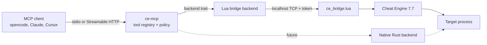

# ce-mcp

**Unofficial MCP server for Cheat Engine — design preview.**

**Documentation site:** <https://jcmunoz200.github.io/ce-mcp/>

> **Status:** this repository currently contains design and migration
> documentation only. There is no implementation yet.
>
> **License:** no license is granted at this time. This is a public design
> preview, not an open-source project yet. See [LICENSE.md](LICENSE.md) and
> [docs/legal/license-status.md](docs/legal/license-status.md).
>
> **Not affiliated** with Cheat Engine or its authors. See
> [docs/legal/trademark.md](docs/legal/trademark.md).

## What is this?

`ce-mcp` is the design for an [MCP](https://modelcontextprotocol.io/) server
that exposes [Cheat Engine](https://cheatengine.org/) tooling to AI agents.

Instead of reimplementing Cheat Engine's UI and scanner first, the project
starts with a **local Lua bridge** into Cheat Engine 7.7. Cheat Engine keeps
executing the operations, so memory access, scans, the address list and Lua
scripts follow Cheat Engine's own semantics. A native Rust backend can replace
the bridge later behind the same MCP contract.

The design goal is complete capability coverage:

- a curated set of typed MCP tools for the common workflows;
- a `lua_eval` escape hatch for the full Cheat Engine Lua API;
- an optional generated tool for every documented Lua function;
- explicit profiles so an agent is not flooded with hundreds of schemas.

## Planned capabilities

| Profile | Contents | Intended use |
| --- | --- | --- |
| `core` | Process, memory, scan, table and Lua tools (~30) | Default agent workflow |
| `full` | Adds symbols, pointer scan, debugger, assembler and structures (~80) | Power users |
| `lua` | One generated tool per documented Lua function (~585) | Full API compatibility |
| `all` | `full` + `lua` | "Every tool" mode |

Planned workflows include:

- list and open processes, enumerate modules, regions and threads;
- read and write memory, values, strings and byte arrays;
- first scan, next scan, unknown value, changed/increased/decreased filters;
- address-list entries, freeze, hotkeys, `.CT` load/save;
- AOB scans, symbol resolution and address parsing;
- disassembly, assembly and Auto Assembler scripts;
- debugger attach, breakpoints, stepping, registers and stack traces;
- structure definitions and reads;
- `lua_eval` and generated Lua tools;
- optional speedhack and trainer helpers.

None of the above is implemented yet. The catalog is specified in
[`spec/`](spec/) and described in [docs/mcp/tool-catalog.md](docs/mcp/tool-catalog.md).
Some planned tools are explicit gaps—most notably pointer scan, stack traces,
UI form automation and trainer generation. See
[Coverage](docs/reference/coverage.md).

## Architecture

- **MCP layer:** stateless MCP `2026-07-28`, explicit handles, pagination,
  tasks for long scans, optional HTTP transport.
- **Backend contract:** the MCP tools never call Mach APIs directly. They call
  a backend trait. The Lua bridge is the first implementation; a native Rust
  backend can be added without changing tool names or semantics.
- **Bridge:** a Lua script loaded into Cheat Engine opens a localhost-only
  socket, authenticates with a token and evaluates requests. It is opt-in and
  never listens on a public interface.
- **Cheat Engine semantics:** once a process is opened, writes are allowed just
  as they are in Cheat Engine. The project does not add a read-only mode by
  default. See [ADR-0005](docs/decisions/ADR-0005-ce-semantics.md).

## Why a bridge first?

Cheat Engine 7.7 documents 585 unique Lua functions. Reimplementing all of them
before shipping an MCP server would take months and would diverge from Cheat
Engine's behavior. The bridge provides:

- immediate coverage of the documented Lua API;
- exact Cheat Engine semantics, because Cheat Engine executes the calls;
- a stable contract to test the MCP design against a real application;
- a migration path: bridge first, native backend later, same tools.

The trade-offs and alternatives are recorded in
[ADR-0006](docs/decisions/ADR-0006-lua-bridge.md) and
[docs/migration/05-backend-strategy.md](docs/migration/05-backend-strategy.md).

## Documentation

Start here:

- [Vision](docs/vision.md)
- [Architecture](docs/architecture.md)
- [Migration overview](docs/migration/README.md)
- [Target inventory: Cheat Engine 7.7](docs/migration/01-target-inventory.md)
- [MCP research](docs/migration/03-mcp-research.md)
- [Decision log](docs/migration/04-decisions.md)
- [Tool migration](docs/migration/06-tool-migration.md)
- [Coverage](docs/reference/coverage.md)
- [Roadmap](ROADMAP.md)

The migration journal starts on
[2026-10-21](docs/migration/journal/2026-10-21.md). It records what was
inspected, what was decided and what remains unknown.

## Non-goals

- Reimplementing the Cheat Engine GUI.
- Distributing Cheat Engine binaries, assets or documentation.
- Bypassing anti-cheat or game protections.
- Kernel drivers, DBVM or Windows-only kernel features.
- A read-only or "safe" mode that changes Cheat Engine semantics by default.

The project is for personal use on processes you own or are authorized to
inspect.

## Contributing

Issues and design feedback are welcome. **Code pull requests are paused until a
license for the future implementation is chosen.** Please read
[CONTRIBUTING.md](CONTRIBUTING.md) before opening an issue.

## License

No license is granted at this time. All rights reserved. The license for the
future implementation will be selected before code contributions are accepted.
See [LICENSE.md](LICENSE.md) and
[docs/legal/license-status.md](docs/legal/license-status.md).

## Trademark

Cheat Engine is a trademark of its respective owner. This project is unofficial
and is not affiliated with, endorsed by or sponsored by Cheat Engine or its
authors. The repository does not include Cheat Engine binaries, assets or
source code. See [NOTICE](NOTICE) and
[docs/legal/trademark.md](docs/legal/trademark.md).
