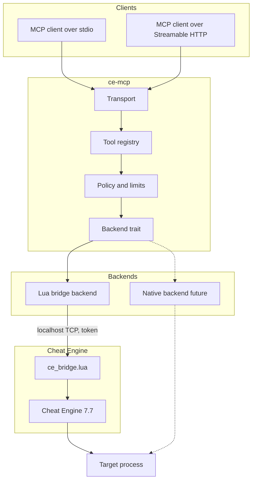

# Architecture

## Overview

`ce-mcp` has four layers:

1. **MCP server** — protocol handling, tool discovery, validation, pagination,
   tasks and transport.
2. **Tool registry** — the machine-readable catalog and the dispatch layer.
3. **Backend contract** — a trait that abstracts Cheat Engine operations.
4. **Backends** — the Lua bridge now, a native Rust engine later.



## MCP server

The server targets MCP `2026-07-28`:

- **Stateless requests.** No `initialize` handshake and no session header.
  Every request carries protocol version and client capabilities in `_meta`.
- **`server/discover`.** Advertises supported protocol versions, capabilities
  and tool profiles.
- **Explicit handles.** Stateful operations return opaque handles:
  `process_handle`, `scan_handle`, `debug_handle`, `table_handle`.
- **Tasks.** Long operations such as pointer scans can return a task handle
  that the client polls with `tasks/get`.
- **Pagination.** Result lists use cursors; the server never returns an
  unbounded array.
- **Caching.** List results carry `ttlMs` and `cacheScope` so clients can cache
  tool and resource lists.
- **Subscriptions.** `subscriptions/listen` carries opt-in change
  notifications for clients that want them.

The transport is stdio by default. Streamable HTTP is optional and binds to
localhost. See [Transports](mcp/transports.md).

## Tool registry

The registry is generated from `spec/`:

- `spec/profiles.yaml` defines `core`, `full`, `lua` and `all`.
- `spec/tools/*.yaml` defines the curated tools.
- `spec/lua-api.yaml` lists the documented Cheat Engine Lua functions and their
  migration status.

Each tool has a stable name, a summary, a profile, platform support, a backend
mapping and a risk class. The same definition produces:

- the Rust registration code;
- the JSON Schema used by MCP;
- the generated tool reference;
- coverage checks.

This avoids documentation drift and makes "all tools" measurable.

## Backend contract

The backend contract is deliberately small. A backend accepts an operation and
returns a structured result:

```rust
trait CheatEngineBackend {
    async fn execute(&self, op: Operation) -> Result<Value, BackendError>;
}
```

The MCP layer owns validation, handles, pagination and error mapping. The
backend owns Cheat Engine semantics. This separation allows:

- the Lua bridge to cover the documented API immediately;
- a native backend to replace tools incrementally;
- tests to use a mock backend without Cheat Engine running;
- a future Windows or Linux bridge without changing the MCP contract.

See [Backend strategy](migration/05-backend-strategy.md).

## Lua bridge

The bridge is a Lua script loaded into Cheat Engine. It:

- opens a TCP socket bound to `127.0.0.1`;
- writes its port and a random token to a user-only file;
- accepts length-prefixed JSON requests;
- authenticates the client before evaluating anything;
- evaluates Lua in Cheat Engine and returns a JSON-safe result;
- runs the accept loop in a thread and uses `synchronize` for GUI operations.

The bridge is opt-in. The MCP server never installs it silently.

The protocol is described in [Protocol](mcp/protocol.md) and
[ADR-0006](decisions/ADR-0006-lua-bridge.md).

## State and handles

MCP is stateless, but Cheat Engine is not. The backend keeps a registry of
handles:

| Handle | Created by | Meaning |
| --- | --- | --- |
| `process_handle` | `process_open` | An open process, including its start time to avoid PID reuse |
| `scan_handle` | `scan_start` | A scan session and its result set |
| `debug_handle` | `debug_attach` | An active debugger session |
| `table_handle` | `table_new` / `table_load` | An address-list/table context |

Handles have a TTL, can be listed with `ce_handles` and are released
explicitly or when the backend shuts down. A handle is opaque; clients must not
parse it.

## Profiles

Profiles keep the tool list manageable:

| Profile | Purpose |
| --- | --- |
| `core` | Default agent workflow |
| `full` | All curated tools |
| `lua` | Generated tools for the documented Lua API |
| `all` | `full` + `lua` |

The default is `core`. A client can request a different profile through server
configuration. See [Profiles](mcp/profiles.md).

## Failure model

- Tool-level errors return a structured error with `code`, `message`,
  `remediation` and `retryable`.
- Protocol-level errors are reserved for malformed requests and unknown tools.
- The bridge can be unavailable, Cheat Engine can be closed, a process can
  exit, or a scan can be cancelled. Each case maps to a distinct error code.
- Long operations are cancellable. The server never blocks the transport while
  a scan runs.

See [Errors](mcp/errors.md).

## Security

The bridge executes Lua by design. It binds to localhost, requires a token and
is opt-in. The project does not bypass SIP, code signing or anti-cheat
protections. See [Security](mcp/security.md) and [SECURITY.md](../SECURITY.md).

## What is not decided yet

- The final implementation license.
- Whether the pointer scan gap is filled by a native tool or by driving the
  Cheat Engine form.
- The exact Lua bridge wire format after the F0 spike.
- Whether the desktop mode ships an embedded HTTP server or a separate process.

These are tracked in the [migration journal](migration/journal/2026-10-21.md).
