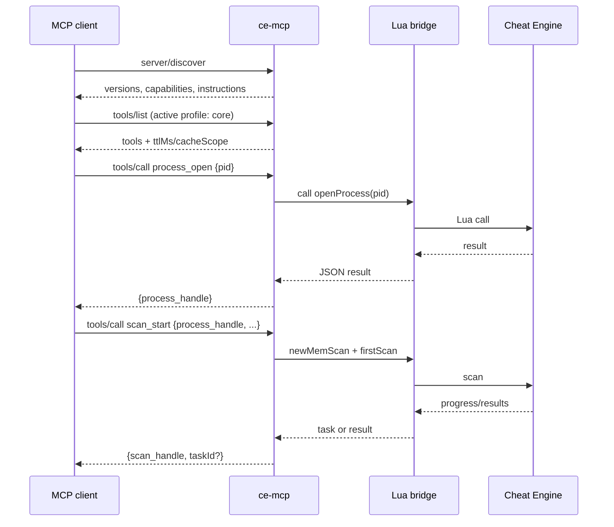

# Protocol

## Target revision

`ce-mcp` targets **MCP `2026-07-28`**.

The protocol is stateless. There is no `initialize` handshake, no
`notifications/initialized` and no `Mcp-Session-Id`. Every request carries its
protocol version and client capabilities in `_meta`; clients should also include
their identity. There is no connection-scoped negotiation.

The planned server uses `rmcp` 3.6 and can also answer `2025-11-25` clients
through its compatibility path.

This page was checked against the official `2026-07-28` versioning, discovery,
tools, caching, pagination and subscriptions pages on 2026-10-21. See the
[references](#references) at the end.

## Discovery

A client may call `server/discover` before any other request. The server must
implement it.

Illustrative request:

```json
{
  "jsonrpc": "2.0",
  "id": "discover-1",
  "method": "server/discover",
  "params": {
    "_meta": {
      "io.modelcontextprotocol/protocolVersion": "2026-07-28",
      "io.modelcontextprotocol/clientInfo": {
        "name": "ExampleClient",
        "version": "1.0.0"
      },
      "io.modelcontextprotocol/clientCapabilities": {}
    }
  }
}
```

Illustrative response:

```json
{
  "jsonrpc": "2.0",
  "id": "discover-1",
  "result": {
    "resultType": "complete",
    "supportedVersions": ["2026-07-28", "2025-11-25"],
    "capabilities": {
      "tools": {}
    },
    "_meta": {
      "io.modelcontextprotocol/serverInfo": {
        "name": "ce-mcp",
        "version": "0.0.0-design"
      }
    },
    "instructions": "Local Cheat Engine tools. Open a process before reading or writing memory.",
    "ttlMs": 3600000,
    "cacheScope": "private"
  }
}
```

The `instructions` field is the right place for the core workflow:

1. call `process_list`, then `process_open`;
2. read or scan with the returned `process_handle`;
3. close handles when finished.

The exact JSON is illustrative until the F0 implementation is tested against the
official schema. The field names come from the `2026-07-28` specification.

## Request metadata

Every request carries:

| Key | Required | Purpose |
| --- | --- | --- |
| `io.modelcontextprotocol/protocolVersion` | Yes | Selected protocol revision |
| `io.modelcontextprotocol/clientInfo` | Optional (SHOULD) | Client name and version |
| `io.modelcontextprotocol/clientCapabilities` | Yes | Extensions and features the client supports |

A request missing a required field is malformed and is rejected with
`-32602` (invalid params); on HTTP the status is `400 Bad Request`. The server must reject a request whose version it
does not support with `UnsupportedProtocolVersionError` (`-32022`) and list the
versions it supports, rather than guessing or silently downgrading. On
Streamable HTTP, the version is mirrored in `MCP-Protocol-Version`; a mismatch
is an HTTP `400` with `HeaderMismatch` (`-32020`), not a tool error. See
[Transports](transports.md#required-http-headers).

## Tools

### Listing

`tools/list` is paginated and cacheable. The result carries `ttlMs` and
`cacheScope`.

- `ttlMs`: 3,600,000 for a stable build; lower during development.
- `cacheScope`: `private` is the conservative default for this local server.
  `cacheScope` describes who may share a cached response, not how the profile
  is configured. Use `public` only when the deployment guarantees an identical
  tool set for every caller and the response contains no per-caller data.

The active profile is part of the server configuration, not of each request, so
the list is stable for the lifetime of a server process.

### Calling

A tool call includes the tool name and arguments. The result is either:

- a normal result;
- an error result with `isError: true` and a structured error object;
- a task creation result if the tasks extension is active and the operation is
  long-running.

Every tool is required to have an `inputSchema` and an `outputSchema` in its
final contract. Output schemas are important: they let clients validate results
and generate better summaries. The six F0 tools have concrete schemas in
[`spec/contracts/f0.yaml`](../../spec/contracts/f0.yaml); the other 75 still need
them. The conventions are in [F0 tool contracts](f0-contracts.md).

### Naming

- Curated tools use lowercase `snake_case` and `domain_action`:
  `process_open`, `memory_read`, `scan_start`.
- Generated Lua tools use the `lua_` prefix plus the original function name,
  preserving its case: `lua_readInteger`. This is the documented exception; it
  keeps generated names aligned one-to-one with `celua.txt`.
- No tool name contains a version number.
- Names are stable within a major version.

## State and handles

MCP is stateless; Cheat Engine is not. State is represented by opaque handles.

| Handle | Created by | Required by |
| --- | --- | --- |
| `process_handle` | `process_open` | Memory, scan, table, debugger and symbol tools |
| `scan_handle` | `scan_start` | `scan_next`, `scan_results`, `scan_cancel` |
| `debug_handle` | `debug_attach` | Breakpoint, stepping, register and stack tools |
| `table_handle` | `table_new`, `table_load` | Table tools |

A handle is a string with no client-parseable meaning. It may be a random ID,
not an address. The backend stores the mapping and validates that the handle is
still alive.

`ce_handles` lists live handles and supports `close`. Handles expire after a
configurable TTL (default: 30 minutes of inactivity). Expired handles return
`CE_HANDLE_EXPIRED`.

## Tasks

Long operations may use the **tasks extension** rather than blocking a request.

- The client opts in with `io.modelcontextprotocol/tasks` in its capabilities.
- The server advertises the extension in `server/discover`.
- A task result has `resultType: "task"` and a `taskId`, status, TTL and
  suggested polling interval.
- Clients poll with `tasks/get`; `tasks/update` supplies input; `tasks/cancel`
  requests cooperative cancellation.

Planned task-producing tools:

- `scan_start` for large regions or slow scans;
- `pointer_scan_start`;
- `pointermap_generate`;
- `memory_dump` for large ranges;
- `trainer_generate`, if implemented.

Short operations return `resultType: "complete"` directly. The server decides
per request; clients must handle both shapes.

## Pagination

Any list that can grow without bound is paginated:

- `scan_results`;
- `table_entries`;
- `process_list` when filtered broadly;
- `region_list` and `module_list` for large targets;
- `lua_api_list`;
- `tool_search` results.

Cursors are opaque and expire. A cursor is tied to the query that produced it;
reusing it with different arguments returns `CE_INVALID_CURSOR`.

## Resources

Resources are optional in the first release. A build that does not implement
them must not advertise a `resources` capability in `server/discover`. Planned
read-only resources:

| URI | Content |
| --- | --- |
| `ce://status` | Bridge status and active profile |
| `ce://process/{handle}` | Process summary |
| `ce://scan/{handle}` | Scan summary and progress |
| `ce://table/{handle}` | Table summary |

Resources are read-only snapshots, not a replacement for tools. They carry
`ttlMs` and `cacheScope` like other cacheable results.

## Subscriptions

Core `subscriptions/listen` supports these filters:

- `toolsListChanged`;
- `promptsListChanged`;
- `resourcesListChanged`;
- `resourceSubscriptions` for specific resource URIs.

Those filters cover list changes and resource updates, not Cheat Engine
runtime events. Process exit, scan progress, breakpoint hits, debugger state
and table changes are **not** core subscription filters. F0 uses polling
(`ce_status`, `scan_status`, `debug_status`) and task state for those events. A
future vendor extension may define an application-specific filter, but it must
not be presented as core MCP behavior.

Subscriptions are optional. A client that does not subscribe can poll
`scan_status`, `debug_status` or `ce_status` instead. The server must not require
a subscription for correctness.

## Errors

Two layers:

1. **Protocol errors** use JSON-RPC error codes for malformed requests, unknown
   methods, unsupported versions and invalid params.
2. **Tool errors** use a successful JSON-RPC response with `isError: true` and a
   structured error object.

A tool error is not a transport failure. The client should read the code and
decide whether to retry, fix the arguments or ask the user.

See [Errors](errors.md).

## Compatibility

- `2026-07-28` is the primary target.
- `2025-11-25` is supported through `rmcp`'s compatibility path for clients that
  still use `initialize`.
- The server must not silently downgrade a request. It reports the versions it
  supports and lets the client choose.
- Features that depend on the tasks extension are advertised as an extension,
  not as core protocol.

## Not used

The design does not depend on:

- roots;
- sampling;
- the legacy logging utility;
- server-initiated JSON-RPC requests;
- HTTP GET streams or `resources/subscribe`;
- session IDs.

## Request flow



## References

- [MCP `2026-07-28`](https://modelcontextprotocol.io/specification/2026-07-28)
- [Versioning and compatibility](https://modelcontextprotocol.io/specification/2026-07-28/basic/versioning)
- [Discovery](https://modelcontextprotocol.io/specification/2026-07-28/server/discover)
- [Tools](https://modelcontextprotocol.io/specification/2026-07-28/server/tools)
- [Caching](https://modelcontextprotocol.io/specification/2026-07-28/server/utilities/caching)
- [Pagination](https://modelcontextprotocol.io/specification/2026-07-28/server/utilities/pagination)
- [Subscriptions](https://modelcontextprotocol.io/specification/2026-07-28/basic/patterns/subscriptions)
- [stdio transport](https://modelcontextprotocol.io/specification/2026-07-28/basic/transports/stdio)
- [Streamable HTTP transport](https://modelcontextprotocol.io/specification/2026-07-28/basic/transports/streamable-http)
- [Transports](transports.md)
- [Tasks extension](https://modelcontextprotocol.io/extensions/tasks/overview)
